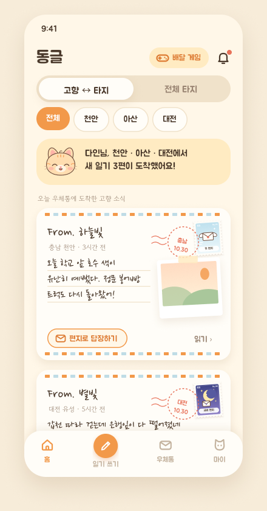
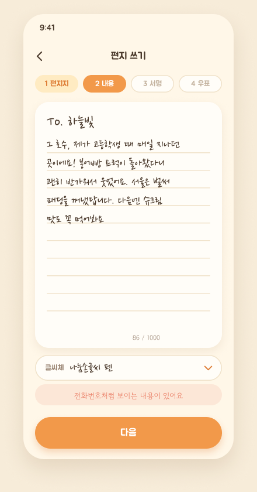
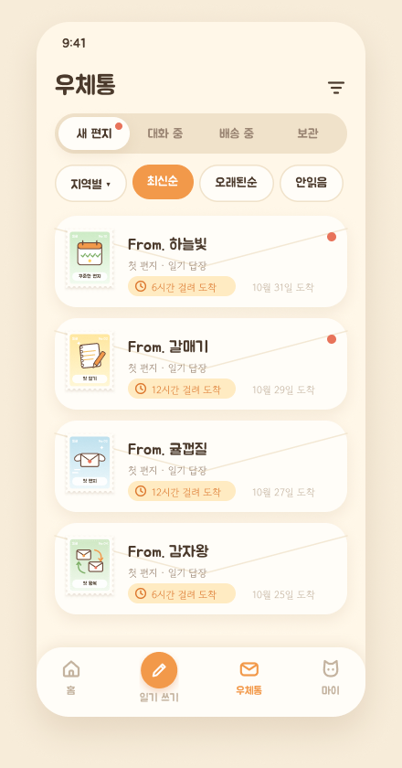

# 동글 | 동네에서 온 글

> 고향을 떠난 대학생이 동네의 일상을 읽고 편지를 주고받는 웹 서비스

## 소개

고향을 떠나 살다 보면, 무심코 지나쳤던 골목이나 익숙한 가게의 소식이 문득 궁금해집니다. 동글에서는 누군가 남긴 짧은 일기로 동네의 오늘을 만나고, 마음에 닿은 글에는 편지로 답할 수 있습니다.

학교 이메일로 가입한 뒤 고향과 현재 사는 지역을 등록하면, 고향에서 올라온 일기를 먼저 볼 수 있습니다. 편지지와 우표를 골라 편지를 보내고 나면, 상대에게 도착하기까지 남은 시간을 우체통에서 확인할 수 있습니다.

## 화면 미리보기

공용 문서에 수록된 화면 시안입니다.

| 홈 피드 | 편지 쓰기 | 우체통 |
| :---: | :---: | :---: |
|  |  |  |

## 기술 스택

| 분류 | 기술 |
| --- | --- |
| 프론트엔드 | React, JavaScript, CSS |
| 라우팅 | React Router |
| 개발 및 빌드 | Vite |
| 배포 구성 | Docker, Nginx |

## 시작하기

Node.js 20.19 이상(20.x) 또는 22.12 이상이 필요합니다.

```bash
git clone https://github.com/2026-4thon-dongle/2026-4thon-11-dongle-frontend.git
cd 2026-4thon-11-dongle-frontend
npm ci
npm run dev
```

브라우저에서 [localhost:5173](http://localhost:5173)을 엽니다. 기본 설정은 배포 API를 사용합니다. 로컬에서 목 데이터로 둘러보려면 `.env.example`을 `.env.local`로 복사하고 `VITE_API_MOCK=true`로 설정한 뒤 개발 서버를 시작합니다.

## 프로젝트 구조

```text
src/
├── app/          # 라우트와 공용 레이아웃
├── pages/        # 홈, 일기, 편지, 우체통, 마이페이지 화면
├── components/   # 기능별 화면 구성 요소
└── shared/       # API 요청, 공용 UI, 디자인 토큰, 목 데이터
tests/            # API 계약과 배달 게임 테스트
```

## 주요 기능

### 고향 일기

글감을 골라 하루를 기록하고 사진 한 장을 첨부할 수 있습니다. 공개 범위는 전체 공개, 같은 고향 사람에게만 공개, 나만 보기 중에서 정할 수 있습니다.

### 고향과 타지 피드

고향에서 올라온 일기를 먼저 보거나, 전체 타지 탭에서 다른 동네의 일상을 지역별로 둘러볼 수 있습니다. 피드 카드의 본문은 최대 3줄까지 표시되며, 카드를 열면 일기 전체를 읽을 수 있습니다.

### 편지 쓰기와 배송

답장을 받을 수 있는 일기에 편지를 보낼 수 있습니다. 편지지, 글씨체, 서명, 우표를 골라 꾸미고, 작성 중인 편지는 임시저장할 수 있습니다. 편지를 보내면 예상 도착 시간을 확인할 수 있습니다.

### 우체통과 펜팔

우체통에서 도착한 편지와 배송 중인 편지를 확인합니다. 펜팔 화면에서는 같은 상대와 주고받은 편지를 모아 읽을 수 있고, 우표첩에서는 수집한 우표를 볼 수 있습니다.

## 검사 명령

```bash
npm run lint
npm run build
npm run test:api
npm run test:game
```
